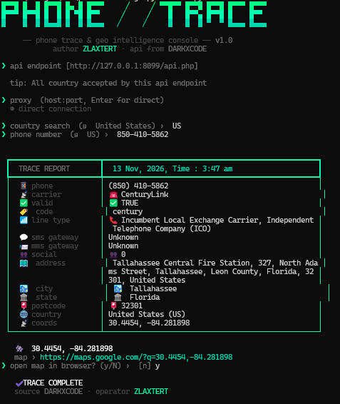

# PHONE-TRACKINGV1
Enter a phone number and its country. The console resolves carrier, line type, SMS gateway, registered area and coordinates — then plots them on the map.

<h1 align="center">
   
  
   
  Trace the number & Locate the signal.
   
</h1>

<h4 align="center">The console resolves carrier, line type, SMS gateway, registered area and coordinates — then plots them on the map.</h4>

  
  

 • <a href="https://api.darkxcode.site/phone-tracking/">View Demo</a> •
  <a href="https://t.me/zlaxtert">Report a Bugs</a> •

## Output

This is the result output.

---

> **NOTE**
> Warning All the information provided here is intended solely for educational and testing purposes. I do not endorse any illegal activities or unfair usage of this program.

